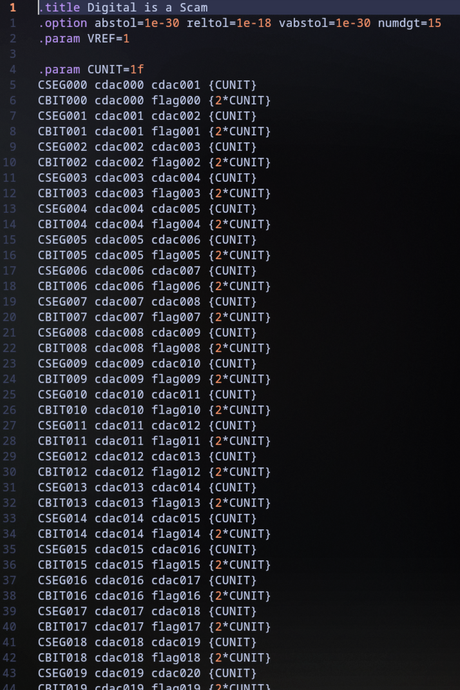
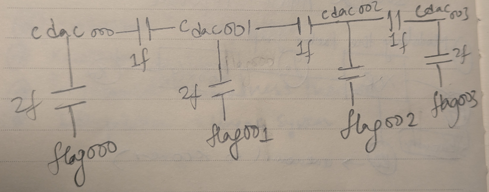
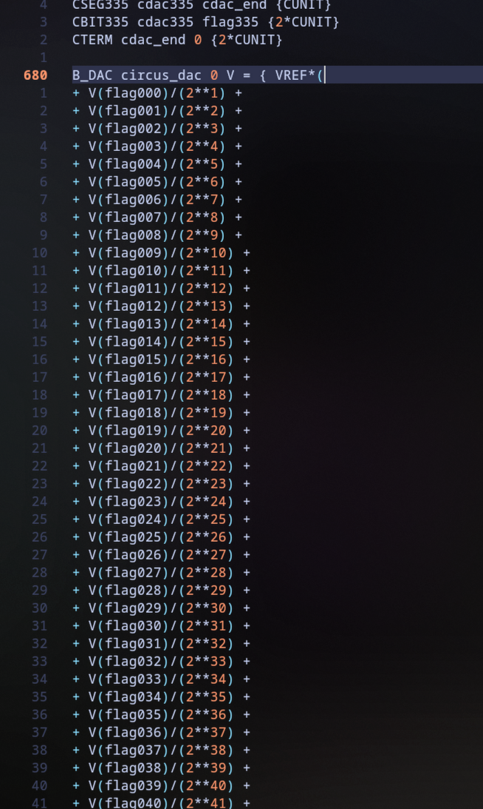
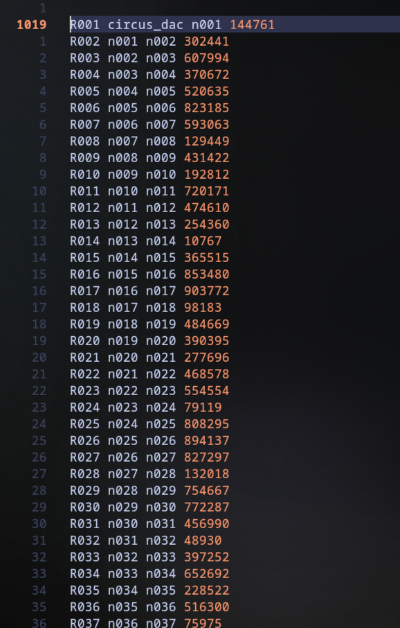
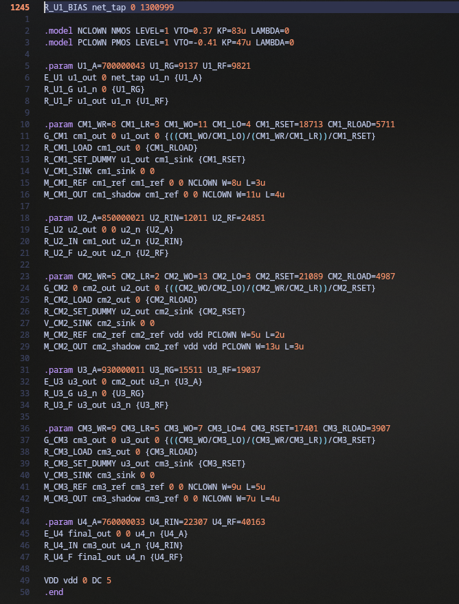

# Digital is a Scam

Category: Hardware/RF

Description:

> Venture into a world of strange circuits, where nothing is as simple as 0 or 1

Flag: `L3AK{Cl0wN1nG_4r0uNd_w1th_4n4LoG_ciRcu1t5}`


after $\infty$ ban waves, i got the #3 solve on this challenge!

## Recon

the challenge had provided a zip file, containing 2 files, a `.spice` netlist and an `output.txt`.

the first thing that i *should've* done was to open the "spice" file in "ltspice", but me being the chud using malware(arch) btw, opened it directly in a text editor.

this was the best decision i made, since after looking at the entire netlist, and running some string matches, i resolved the challenge into what is important and what isn't.

before i talk about that, i would like to point out that using both ltspice(AUR version with wine) and ngspice threw me errors, so theres that.

```
C:\users\pseudonymous\Desktop\ctfs\leak\hardware_digital-is-a-scam\digital_is_a_scam.spice(2): 
syntax error .option abstol=1e-30 reltol=1e-18 vabstol=1e-30 numdgt=15
```

since numdgt isn't a part of ltspice, the only plausible option was ngspice.

but ngspice also threw a syntax error, so i guess this way wasn't the correct one to even analyze the netlist.

after opening a ticket, i utilized some online based tools, but the entire thing wasn't loading so, i came back to my nvim.

---

## The useless part



### syntax explaination

`CSEG000 cdac000 cdac001 {CUNIT}` -> cdac000 -----|1f capacitor|----- cdac001

CSEG000 is the capacitor name, where cdac000 & cdac001 are capacitor nodes, with {CUNIT} being the capacitor value.

in the first ~670 lines, this entire chain is being built, where 1 extra capacitor (CBITxxx) has a flag bit onto it.

this is how the network will look like:



but funny enough, since a capacitor acts as a high-pass filter & entire circuit is DC, `CTERM cdac_end 0 {2*CUNIT}` is never enforced/executed, so all the `flagxxx` nodes are dead.

enter the big circus_dac 🔥(i added ts myself, not ai gen lol):



---

## The useful part

### syntax explaination

`B_DAC circus_dac 0 V=`

`B_DAC` is a behavioral source named `DAC`, where the +ve terminal is circus_dac and -ve terminal is GND.

what a behavioral source does is that it enforces an eqn onto a node, such that the it equals the eqns value.

here `flagxxx` is a bit, ie, 0 or 1v. this sum is also how we do base2/binary fractions in decimal.

therefore, the entire eqn will collapse to `circus_dac = flag000/2^1 + flag001/2^2 + flag002/2^3 + ... + flag335/2^336`, anyway, this part is just the packing of the bits.

uptil now, everything we have covered is ~1000 lines out of the total 1300 lines in the netlist.

### the real stuff ->



from `R001` till `R226` and `R_U1_BIAS`, which feeds into the `net_tap` node, we have a huge resistor mesh.

### syntax explaination

`R001 circus_dac n001 144761`

`R001` is the resistor, `circus_dac` and `n001` are the nodes, and the value of the resistor is 144761ohm.

to solve the nodes:

```
def solve_mesh(mesh_edges):
    #collect all nodes
    nodes = set()
    for a, b, _ in mesh_edges:
        nodes.add(a); nodes.add(b)

    #discarding to remove known voltages so that we can only solve for variables.
    nodes.discard('0')
    nodes.discard('circus_dac')
    nodes = sorted(nodes)
    idx = {n: i for i, n in enumerate(nodes)}
    N = len(nodes)

    G = sp.zeros(N, N) #conductance matrix
    I = sp.zeros(N, 1) #current vector
    
    Vsrc = sp.Rational(1)  # test excitation: circus_dac = 1 V

    for a, b, val in mesh_edges:
        g = sp.Rational(1, val)     #g = 1/resistance
        if a == '0' or b == '0':
            other = b if a == '0' else a
            j = idx[other]
            G[j, j] += g            #node has path to gnd
        elif a == 'circus_dac' or b == 'circus_dac':
            other = b if a == 'circus_dac' else a
            j = idx[other]
            G[j, j] += g
            I[j] += g * Vsrc        #node is injecting current
        else:
            i_, j = idx[a], idx[b]
            G[i_, i_] += g
            G[j, j] += g
            G[i_, j] -= g
            G[j, i_] -= g
 
    sol = G.solve(I)
    return sol[idx['net_tap']]
```

since the mesh collapses at `net_tap`, we move on to the FET part, as there are some `NMOS` and `PMOS` definitions.

```
.model NCLOWN NMOS LEVEL=1 VTO=0.37 KP=83u LAMBDA=0
.model PCLOWN PMOS LEVEL=1 VTO=-0.41 KP=47u LAMBDA=0
```



### syntax explaination

- `E_U1 u1_out 0 net_tap u1_n {U1_A}`

`E` is Voltage-Controlled Voltage Source in spice.

`V(u1_out) - V(0) = {U1_A} * (V(net_tap)-V(u1_n))`

- `G_CM1 cm1_out 0 u1_out 0 {gm1}`

`G` is a Voltage-Controlled Current Source in spice.

this pushes a current of `gm1 * (V(u1_out)-V(0))` between nodes `cm1_out` and `0`

### pipeline

```
net_tap
  |
Ideal Op-Amp (U1)      useful   - E_U1, R_U1_G, R_U1_F
  |
Current Mirror (CM1)   useful   - G_CM1, R_CM1_LOAD
  |
    - not useful  - R_CM1_SET_DUMMY, cm1_sink, V_CM1_SINK (dead end)
    - not useful  - M_CM1_REF, M_CM1_OUT (cm1_ref / cm1_shadow, dead end)
  |
Ideal Op-Amp (U2)      useful   - E_U2, R_U2_IN, R_U2_F
  |
Current Mirror (CM2)   useful   - G_CM2, R_CM2_LOAD
  |
    - not useful  - R_CM2_SET_DUMMY, cm2_sink, V_CM2_SINK (dead end)
    - not useful  - M_CM2_REF, M_CM2_OUT (cm2_ref / cm2_shadow, VDD, dead end)
  |
Ideal Op-Amp (U3)      useful   - E_U3, R_U3_G, R_U3_F
  |
Current Mirror (CM3)   useful   - G_CM3, R_CM3_LOAD
  |
    - not useful  - R_CM3_SET_DUMMY, cm3_sink, V_CM3_SINK (dead end)
    - not useful  - M_CM3_REF, M_CM3_OUT (cm3_ref / cm3_shadow, dead end)
  |
Ideal Op-Amp (U4)      useful   - E_U4, R_U4_IN, R_U4_F
  |
final_out
```

### solving the final op-amp/fet chain

since every op-amp here has a real (finite) gain, we can't just slap `1+Rf/Rg` or `-Rf/RiN` on it.

this formula only work if limit as gain goes to infinity, if we plug in `U1_A = 700000043` and we will be off by some small factor.

### non-inverting stage (U1, U3)

```
E_U1 u1_out 0 net_tap u1_n {U1_A}
R_U1_G u1_n 0 {U1_RG}
R_U1_F u1_out u1_n {U1_RF}
```

here,

`E_U1 u1_out 0 net_tap u1_n {U1_A}`, already covered in the above explaination.

`R_U1_G u1_n 0 {U1_RG}`, this is plain resistor from `u1_n` to gnd. this is the "gain-setting" resistor, sitting on the op-amp's own - input, nowhere else.

`R_U1_F u1_out u1_n {U1_RF}` also a plain resistor, from the op-amp's output back to its own -ve input. this is the feedback resistor, ie making it a closed-loop amplifier.

KCL at `u1_n` (op-amp input draws no current, so the only two things touching this node are `R_U1_G` and `R_U1_F`):

`u1_n/R_G + (u1_n - u1_out)/R_F = 0`

and as we know the value of `E_U1` to be `u1_out = A * (net_tap - u1_n)`, we have 2 eqns and 2 vars to solve for.

soln: `u1_out = A*(R_G+R_F)*net_tap / (R_G+R_F+A*R_G)`

### inverting stage (U2, U4)

same idea as above, but diff pin.

```
E_U2 u2_out 0 0 u2_n {U2_A}
R_U2_IN cm1_out u2_n {U2_RIN}
R_U2_F u2_out u2_n {U2_RF}
```

here,

`E_U2 u2_out 0 0 u2_n {U2_A}`, same VCVS syntax as `E_U1`, but the +ve input is hardcoded to node 0 (ground) instead of a signal node:
`V(u2_out) = U2_A * (0 - V(u2_n))`
that's what makes this stage inverting, the +ve pin is grounded, and the real input comes in through the -ve pin instead.

`R_U2_IN cm1_out u2_n {U2_RIN}`, resistor from the previous stage's output, `cm1_out` into this op-amp's -ve input.
this is the "input resistor," standing in the same electrical role `R_U1_G` played for `U1`, just wired differently because this is an inverting topology.

`R_U2_F u2_out u2_n {U2_RF}`, feedback resistor, same job as `R_U1_F`.

KCL at `u2_n` gives `(u2_n - cm1_out)/R_IN + (u2_n - u2_out)/R_F = 0`
and `E_U2` gives `u2_out = A*(0 - u2_n)`

again, 2 eqns, 2 vars.

soln: `u2_out = -cm1_out * R_F / (R_IN + R_F/A + R_IN*R_F/(A*R_IN))`

`U3` is literally the same derivation as `U1` (non-inverting), `U4` is literally the same derivation as `U2` (inverting).
its just different node names and different `R` values plugged in. not repeating the algebra for those.

### current-mirror stages (CM1, CM2, CM3)

```
G_CM1 cm1_out 0 u1_out 0 {gm1}
R_CM1_LOAD cm1_out 0 {CM1_RLOAD}
```

`G_CM1` (already covered above) pushes `gm1*u1_out` between `cm1_out` and `0`, no resistor in that line so it's current only, not voltage.

`R_CM1_LOAD` is what actually turns that current into a voltage on `cm1_out`.
(V=IR, since `cm1_out` has nowhere else to go): `cm1_out = -gm1*R_load*u1_out`.

```
G_CM1: cm1_out = -gm1 * R_CM1_LOAD * u1_out
G_CM2: cm2_out = +gm2 * R_CM2_LOAD * u2_out   (nodes reversed -> sign flips)
G_CM3: cm3_out = -gm3 * R_CM3_LOAD * u3_out
```

`G_CM1` and `G_CM3` are written the same way, `(cm_out 0 v_in 0 {gm})`, but `G_CM2` has its first two nodes swapped, so the sign will flip.

finally...

we feed `net_tap` through the whole cascade `(U1 -> CM1 -> U2 -> CM2 -> U3 -> CM3 -> U4)` using the exact eqns above at every stage.

oh also, the reason we derived it instead of using gain -> inf, is because we need precision, if i use the shortcuts, my answer will be right till ~10-20 significant digits only.

since every single stage is linear and `circus_dac` is the only independent source anywhere in this downstream network (no other voltage/current sources feeding in anywhere), the whole thing collapses into one constant:

`final_out = K * circus_dac`

`K ≈ 0.2028947523...`, which comes from multiplying the mesh's own factor by all 7 stage gains, done entirely in sympy.
its rational/fraction, never floats, since we need this exact to way more precision than a double can hold.

### unpacking output.txt

`output.txt` contains:

```
0.06039306157438400102794045486708946486034499491533402798629016156349210296901436636372391770785372431818507877599969555416681372559898606240446413825393499185362033262469057837582493372819532013490169456817896369308861966535677156574646514140136280483537096440578882618977289763857546058786365688674531396471876298959875630060121697196228499630453449119643567782387165244066882238
```

this is just the output of `final_out`, so we can easily get `circus_dac` from it.

```
circus_dac = output.txt / K
scaled = circus_dac * 2**336 #to undo all the /2, /2**2 packing
n = round(scaled)

bits = bin(n)[2:].zfill(336) #flag000 <- msb
flag = int(bits,2).to_bytes(42, 'big')
```

thats all ig.

link to solve script -> [solvescript](solve.py)

```
$ python solve.py 
K (final_out/circus_dac)   = 0.20289475231495493
circus_dac                 = 0.29765709011850355
FLAG: L3AK{Cl0wN1nG_4r0uNd_w1th_4n4LoG_ciRcu1t5}
```

## final notes ig?

pretty good challenge, it was quite the change from hardware challenges that i see, its usually either some firmware rev or some rf.

the only advantage i think hardware has over normal ctf categories is that you cant really slop it, and even if you are using llms, it can only be used as a very controlled assistant, its like roadside assistance instead of a self driving car.

overall, really enjoyed the challenge, was a break from what im used to.
